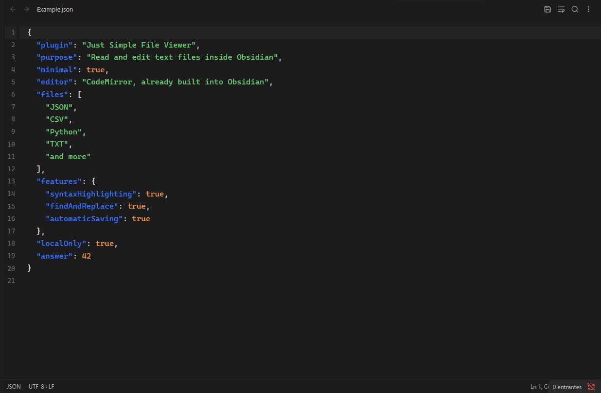

# Just Simple File Viewer

There are already Obsidian plugins that open many kinds of files and offer extensive editing features. **Just Simple File Viewer deliberately aims for minimalism:** a small, focused way to read and edit text files in normal Obsidian tabs.

Open JSON, CSV, Python, TXT, configuration files and other text files, edit the source directly, and keep everything in your vault. It reuses the CodeMirror editor already built into Obsidian and bundles only selected syntax parsers. The JavaScript is about **77 KiB uncompressed**.

No Office viewers, document conversion engines, separate editor runtime, accounts or remote services. Just text.



## Features

- Normal Obsidian tabs, splits and pop-out windows.
- Automatic saving after 750 ms without typing, plus immediate save with Ctrl/Cmd+S and on tab close.
- Syntax highlighting for JSON, JavaScript, TypeScript, Python, CSS, HTML/XML, YAML, TOML, shell scripts, diff and properties files.
- Other languages and CSV/TSV remain editable plain text.
- Find and replace with case matching, whole words and regular expressions (Ctrl/Cmd+F or Ctrl/Cmd+H).
- Undo/redo, multiple selections, line numbers, indentation and optional word wrap (Alt+Z).
- Native theme colors and monospace font; no separate editor theme to configure.
- Checks file contents before editing and refuses known binary formats.
- Atomic conflict checking: external changes are reloaded when the tab is clean; concurrent edits show a conflict banner instead of silently overwriting either version.
- If a dirty tab closes after a conflict or save failure, its local edits are saved in a separate recovery copy.

## Use

Click a supported file in the vault file explorer. For any other text extension, use **Just Simple File Viewer: Open text file** from the command palette, or right-click a file and choose **Open as text**. This also handles files without extensions, such as `Makefile`, and dotfiles that Obsidian exposes through its vault API. Obsidian's hidden configuration folder is outside this API.

In settings, add extensions separated by commas. Reload the plugin to apply extension associations. Markdown, Canvas, Bases, SVG and extensions already owned by another view keep their normal default viewer; **Open as text** can explicitly open their textual source. Known Office, PDF, image, archive and executable extensions are excluded.

CSV is edited as source text, not a table. HTML and SVG are shown as text and never executed or rendered. There are no code execution, language server, completion, preview or Office features.

## Text format and large files

Version 0.1 supports UTF-8, including UTF-8 with BOM. Other encodings are refused without changing the file; convert a copy to UTF-8 first. Standard LF, CRLF and CR line endings, the BOM and the absence of a final newline are preserved. A file with mixed line endings adopts its first line-ending convention when edited.

Files up to 20 MiB can be opened. Syntax highlighting is omitted above 1,048,576 characters. CodeMirror only renders the visible part of the document, although the file itself must fit in memory. These limits are safeguards, not a promise of identical performance on every device.

## Install

Requires **Obsidian 1.13.0 or later**.

1. Download `main.js`, `manifest.json` and `styles.css` from the [latest release](https://github.com/DavidHurtadoAI/just-simple-file-viewer/releases/latest).
2. Create `<vault>/.obsidian/plugins/just-simple-file-viewer/` and copy the three files into it. Alternatively, extract the release ZIP into `<vault>/.obsidian/plugins/`.
3. Reload Obsidian and enable **Just Simple File Viewer** under **Settings → Community plugins**.

## Development

```sh
npm ci
npm run check
npm run dev
```

Uses Obsidian's existing CodeMirror 6 modules for editing, history, search and viewport rendering. Only selected MIT-licensed CodeMirror stream parsers are included in the plugin bundle. No Monaco, React, network access, telemetry, CDN or separate editor runtime. See `THIRD-PARTY-NOTICES.md`.

The minimum app version is a conservative API baseline. Desktop integration is tested in the development vault; mobile compatibility uses the same public APIs but requires device testing.
